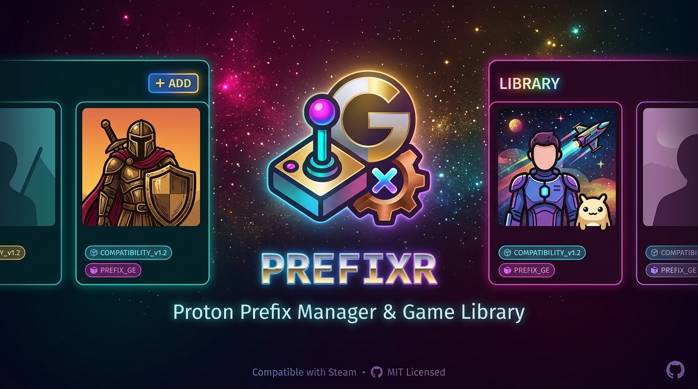
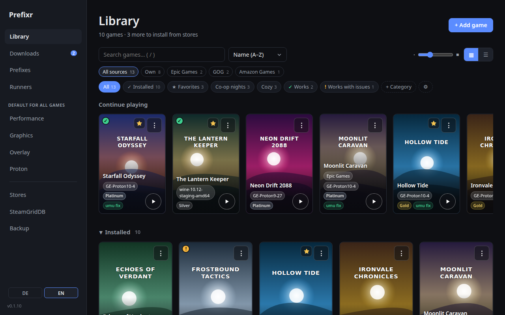

<div align="center">
  <h1>Prefixr</h1>

  <p><strong>The agentic game launcher for Linux: let an AI agent handle all your games.</strong></p>

  <p>
    Your agent adds your Windows games, picks Wine or Proton, fixes the ones that won't start and
    sorts your library into categories, while you watch the window and play. Prefixr manages the
    prefixes, downloads runners like Proton-GE, and sets up each game with MangoHud, Gamescope,
    GameMode and Steam artwork. Everything an agent does through its command line also works with a
    few clicks.
  </p>

  

  <p>
    <a href="https://github.com/firsttris/prefixr/releases/latest"></a>
    <a href="https://github.com/firsttris/prefixr/actions/workflows/ci.yml"></a>
    <a href="#-requirements"></a>
    <a href="LICENSE"></a>
    <a href="https://firsttris.github.io/prefixr/"></a>
  </p>

  <p>
    <a href="#-installation"><strong>Install</strong></a> ·
    <a href="https://firsttris.github.io/prefixr/"><strong>Documentation</strong></a> ·
    <a href="https://firsttris.github.io/prefixr/troubleshooting.html"><strong>Troubleshooting</strong></a> ·
    <a href="https://github.com/firsttris/prefixr/issues"><strong>Report a bug</strong></a>
  </p>
</div>

---

## What is Prefixr?

Prefixr is a desktop app for playing **Windows games on Linux**, made to be run by an **AI agent**
as much as by you. Hand your game folders to an agent such as
[Claude Code](https://claude.com/claude-code) and it does the setup through Prefixr's command line
([see below](#-let-an-ai-agent-run-your-library)), or do it yourself: in the window you add a game's `.exe`, pick a
**Wine or Proton prefix** and a **runner**, and Prefixr takes care of the rest: it creates the
prefix, launches the game through [umu-launcher](https://github.com/Open-Wine-Components/umu-launcher)
the way Steam launches Proton, applies [protonfixes](https://github.com/Open-Wine-Components/umu-protonfixes),
installs DXVK and VKD3D-Proton for plain Wine builds, and lets you tune every game on its own.

It is built for people who want their GOG, Epic, Amazon, itch.io or standalone games next to their Steam
library, without editing launch scripts. If you know [Lutris](https://lutris.net/),
[Bottles](https://usebottles.com/), [Heroic](https://heroicgameslauncher.com/) or
[PortProton](https://linux-gaming.ru/), Prefixr covers the same ground with a focus on prefixes:
you can reuse an existing prefix from any of them as it is.

## ✨ Features

| | |
| --- | --- |
| 🎮 **Game library** | Grid and list views with search, a card size slider and sorting by name, last played, recently added or play time. Installed games and your stores' games to install in their own sections, a *Continue playing* row, a details panel per game with play time, size and settings, launch arguments and environment variables per game, desktop and app menu shortcuts. |
| 🗂️ **Organizing** | Your own categories (*Kids*, *Co-op*, …), favorites and hidden games, as chips above the library. A game can be in several categories, and a store game keeps them when it's installed. An AI agent can sort a whole library into categories for you. |
| 🩺 **Compatibility** | See before installing whether a game runs: its [ProtonDB](https://www.protondb.com) rating and whether umu-protonfixes has fixes for it, as badges on every card. |
| 📦 **Installers** | Open a setup `.exe` with *Install Prefixr* from your file manager's *Open With* menu. The installer runs in the prefix you choose, and the shortcut it creates is offered as the game to add. |
| 🍷 **Prefixes** | Create new Wine/Proton prefixes or import existing ones from Steam, Lutris, Bottles or PortProton. Each prefix is listed by the games that use it, with search and filters (unused, shared, not set up yet, folder missing) that keep a few hundred of them manageable. Install dependencies with [winetricks](https://github.com/Winetricks/winetricks) and open `winecfg`, `regedit` and Wine's other tools from the app. |
| ⬇️ **Runners** | Download Proton-GE, Proton-CachyOS and Wine (Kron4ek) from their GitHub releases, checksum-verified. Any Proton or Wine build you place or symlink in the runners folder shows up as well. |
| 🚀 **Launching** | Proton games run through umu-launcher in the Steam Linux Runtime, with an automatic UMU ID lookup for protonfixes. Wine games get DXVK, VKD3D-Proton and wine-mono set up automatically. |
| 🎛️ **Per-game tuning** | [MangoHud](https://github.com/flightlessmango/MangoHud) with presets, [GameMode](https://github.com/FeralInteractive/gamemode), power profiles, [Gamescope](https://github.com/ValveSoftware/gamescope), [vkBasalt](https://github.com/DadSchoorse/vkBasalt) and every `PROTON_*` switch your runner supports. Set them once globally, override them per game. |
| 🛒 **Stores** | Connect your Epic Games, GOG and Amazon Games accounts and their games show up in the library, ready to install with one click: a prefix of their own, your newest Proton, the store's cover. A *Downloads* page shows the installs with their speed and time left. Epic's online games start with their login tokens. Powered by Heroic's [Legendary](https://github.com/Heroic-Games-Launcher/legendary) and [gogdl](https://github.com/Heroic-Games-Launcher/heroic-gogdl) and [Nile](https://github.com/imLinguin/nile), downloaded on connect at pinned, checksum-verified versions. |
| 🖼️ **Artwork & Steam** | Covers, icons, heroes and logos from [SteamGridDB](https://www.steamgriddb.com/). Add any game to Steam as a non-Steam game, artwork included, so it shows up in Big Picture and Game Mode on the Steam Deck. |
| ⌨️ **Command line** | The window's work as commands: `prefixr game add`, `prefixr game install`, `prefixr prefix winetricks`, `prefixr runner download`, `prefixr category assign`, `prefixr store install` and more, with JSON output for scripts and agents. An open window shows the changes right away. |
| 💾 **Backup** | Back up the library, every setting, categories, play times and artwork to one file, and restore it. Prefixr always backs up before a restore, and on request automatically every few days, so a change can be undone. |
| 🧰 **Everyday comfort** | Tray icon with the running games and a way to stop a hung one, logs of the last 10 runs per game and prefix, a `vm.max_map_count` check, English and German UI. |



See the [user guide](https://firsttris.github.io/prefixr/user-guide.html) for a tour of every feature.

## 🤖 Let an AI agent run your library

Prefixr is built so that an AI coding agent such as [Claude Code](https://claude.com/claude-code)
can do the work for you through its [command line](https://firsttris.github.io/prefixr/cli.html).
You say what you want, the agent does it, and you watch the window update and play. Run
`prefixr skill install` once, and Claude Code knows how to work with Prefixr from the start
([more](https://firsttris.github.io/prefixr/cli.html#the-prefixr-skill)).

- **Add games:** it looks at your game folders, adds each game with the right runner and prefix,
  finds its [protonfixes](https://github.com/Open-Wine-Components/umu-protonfixes) match, installs
  winetricks packages and picks the artwork.
- **Install from your stores:** it connects your Epic Games, GOG and Amazon accounts (you sign in
  once in the browser) and installs their games.
- **Install from a setup file or a disc:** give it an installer `.exe` or a disc image (`.iso`), and
  it runs the installer in a new prefix (silently where the installer allows it) and adds the game.
- **Move games over:** it carries over the fixes from old launch scripts or other launchers and
  copies your save games.
- **Fix games:** when a game doesn't start, it reads the log and changes the setup until it does.
- **Test games:** with a computer-use tool for the Linux desktop (see the tip below), it starts
  each game, looks at the screen, and marks it on its cover as working (✓), working with issues
  (!) or broken (✕), with a note on what it saw.
- **Organize the library:** it creates categories such as *Kids* and *Adults* and sorts every game
  into them, marks favorites and hides what you won't play.
- **Keep notes:** it writes down what it found (an offline login, why a setting is needed) with
  the game, for the next time.

```text
You:   Add all games under /mnt/games/ to Prefixr. Each one has its own Wine and a
       start script; give them Proton-GE instead and keep the fixes from the scripts.
Agent: prefixr runner download proton-ge
       prefixr umu search "Fallout 4"
       prefixr game add --name "Fallout 4" --exe ".../Fallout4.exe" --prefix ~/Games/prefixes/fallout4 \
         --runner GE-Proton10-30 --umu-id 377160 --env DXVK_FRAME_RATE=58
       prefixr game artwork "Fallout 4"
       …
```

```text
You:   Create the categories Kids and Adults and sort all my games into them.
Agent: prefixr library list --json
       prefixr category add Kids
       prefixr category add Adults
       prefixr category assign Kids epic:Fortnite gog:1207658924 "Stardew Valley"
       prefixr category assign Adults "Fallout 4" "Cyberpunk 2077"
```

When a game doesn't start, the agent reads its log with `prefixr game log <game> --print` and fixes
the setup.

> **Tip: let the agent check that your games work.** Give the agent a computer-use tool for the
> Linux desktop, an MCP server that lets it take screenshots and use the mouse and keyboard (for
> example [Computer Use MCP Server](https://conare.ai/marketplace/mcp/computer-use) for X11, or
> [codex-computer-use-linux](https://glama.ai/mcp/servers/maxionice/codex-computer-use-linux),
> which also works on Wayland). Then ask: *"Add all games under `/mnt/games/` and check whether
> each one starts."* The agent launches every game, looks at what's on screen (the menu, a black
> window, an error dialog), stops it, and fixes or reports the ones that don't run. These are
> community projects that get full control of your desktop: read what they do before you install
> one. See [Working with an AI agent](https://firsttris.github.io/prefixr/cli.html#working-with-an-ai-agent).

## 📦 Installation

Download the latest build from the [releases page](https://github.com/firsttris/prefixr/releases/latest):

| Package | For | Install |
| --- | --- | --- |
| `.AppImage` | Any distribution | `chmod +x prefixr_*.AppImage && ./prefixr_*.AppImage` |
| `.deb` | Debian, Ubuntu, Linux Mint, Pop!_OS | `sudo apt install ./prefixr_*_amd64.deb` |
| `.rpm` | Fedora, openSUSE, Nobara | `sudo dnf install ./prefixr-*.x86_64.rpm` |
| `.flatpak` | Any distribution with Flatpak (releases after 0.1.10) | `flatpak install --user ./prefixr_*_x86_64.flatpak` |

On immutable distributions such as Bazzite or SteamOS, use the Flatpak or the AppImage. If the AppImage shows a
blank window or crashes with `EGL_BAD_PARAMETER`, see
[Troubleshooting](https://firsttris.github.io/prefixr/troubleshooting.html#appimage-crashes-egl_bad_parameter-or-shows-a-blank-window).

To build Prefixr yourself, follow [Building from source](https://firsttris.github.io/prefixr/development.html#building-from-source).

## ✅ Requirements

- Linux on x86_64 with a Vulkan-capable GPU driver (Mesa or NVIDIA)
- 32-bit graphics libraries for older games, as your distribution packages them for Steam
- **Optional:** Steam (to import prefixes and add games to Steam), MangoHud, GameMode,
  power-profiles-daemon, Gamescope and vkBasalt for the matching settings

Prefixr downloads umu-launcher, runners, DXVK, VKD3D-Proton, wine-mono and winetricks itself when
they're first needed. The [getting started guide](https://firsttris.github.io/prefixr/getting-started.html) walks through the first
game.

## 📚 Documentation

The documentation is also available as a website:
**[firsttris.github.io/prefixr](https://firsttris.github.io/prefixr/)**.

| Guide | What's in it |
| --- | --- |
| [Getting started](https://firsttris.github.io/prefixr/getting-started.html) | Install Prefixr and get your first game running |
| [User guide](https://firsttris.github.io/prefixr/user-guide.html) | The library, prefixes, runners, per-game settings, artwork and Steam |
| [Configuration & files](https://firsttris.github.io/prefixr/configuration.html) | Where Prefixr keeps its data, command-line options, API keys |
| [Command line & AI agents](https://firsttris.github.io/prefixr/cli.html) | Every command, JSON output, the Prefixr skill, and letting an AI agent set up, fix and organize your games |
| [Troubleshooting & FAQ](https://firsttris.github.io/prefixr/troubleshooting.html) | Common problems and how to fix them |
| [Development](https://firsttris.github.io/prefixr/development.html) | Building from source, architecture, tests and releases |

## 🤝 Contributing

Bug reports, ideas and pull requests are welcome. Please open an
[issue](https://github.com/firsttris/prefixr/issues) first for larger changes. The
[development guide](https://firsttris.github.io/prefixr/development.html) explains how to set up the project, which checks CI runs,
and how texts and translations work.

---

<div align="center">

⭐ Like Prefixr? A [star on GitHub](https://github.com/firsttris/prefixr) helps others find it.<br>
🐛 [Report a bug](https://github.com/firsttris/prefixr/issues/new) · 💡 [Request a feature](https://github.com/firsttris/prefixr/issues/new)

<sub>License: <a href="LICENSE">GPL-3.0</a> · © Tristan Teufel and contributors<br>
Changed versions you pass on must stay under the GPL and come with their source code; a commercial license without these obligations is available via <a href="https://teufel-it.de">teufel-it.de</a>.<br>
Prefixr is not affiliated with Valve, Steam, WineHQ, CodeWeavers or SteamGridDB.</sub>

</div>
